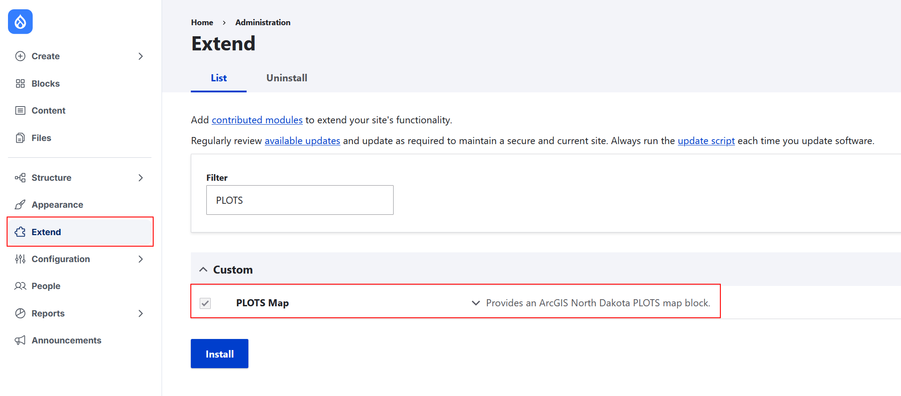

PLOTS Map block (Drupal 11)
==========================

### Live Demo
To see this custom module in action, check out the live [map](https://backtrack.nonzero.pro/map) hosted at https://backtrack.nonzero.pro/.

### Install Instructions
Download the module source code:
1. Clone this repo into your Drupal site's modules/custom directory

```bash
# This is the default drupal 11 install custom modules path. Create the modules/custom folder if it doesn't exist, and ensure your user has write permissions
cd /var/www/drupal/web/modules/custom
git clone https://github.com/0x618/backtrack plots_map
```

2. Within the Drupal Admin UI, navigate to **Extend**, search for "PLOTS", then check the box to enable the custom PLOTS Map module.


Place the map:
1. Go to Structure > Block layout > Place block.
2. Select "North Dakota PLOTS map" under the Maps category.
3. Optionally adjust the starting longitude, latitude, and zoom.

### Data and map attribution
PLOTS data is sourced from the [North Dakota Game and Fish Department and the ND GIS Hub](https://ndgishub.nd.gov/arcgis/rest/services/Applications/GNF_PLOTSGuideCached/MapServer).
The basemap is Esri's [Human Geography Dark](https://www.arcgis.com/home/item.html?id=4f2e99ba65e34bb8af49733d9778fb8e).